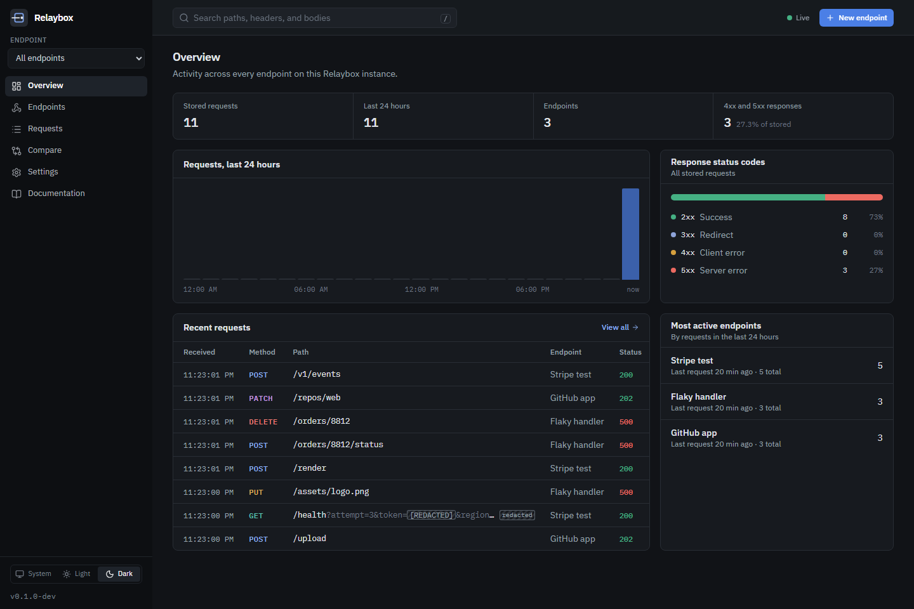
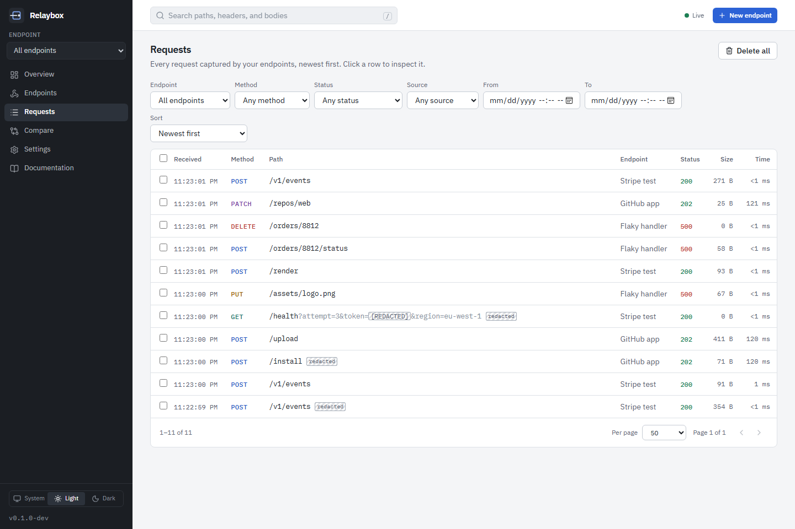
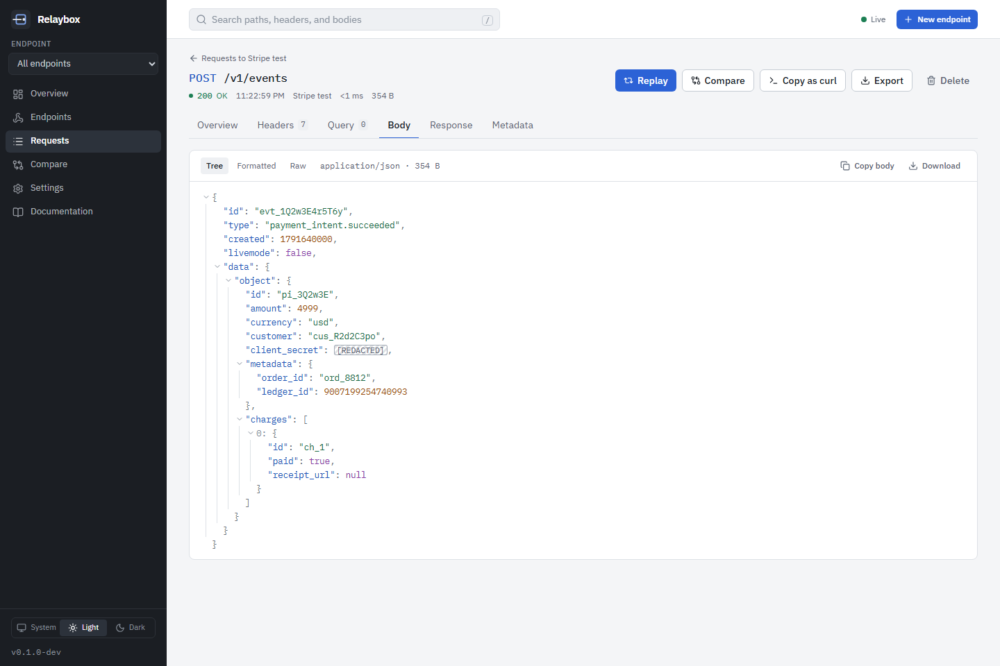
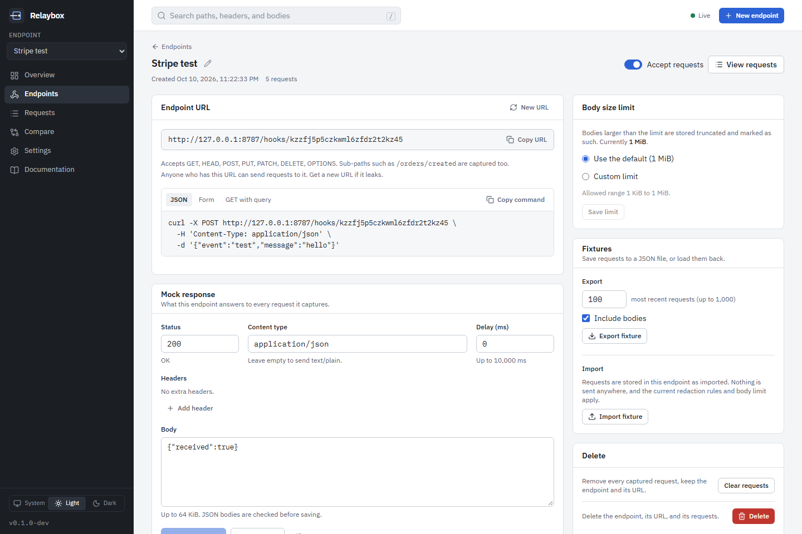
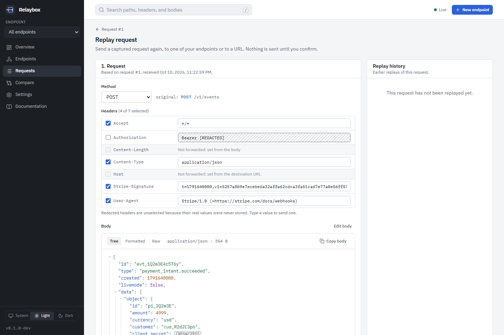
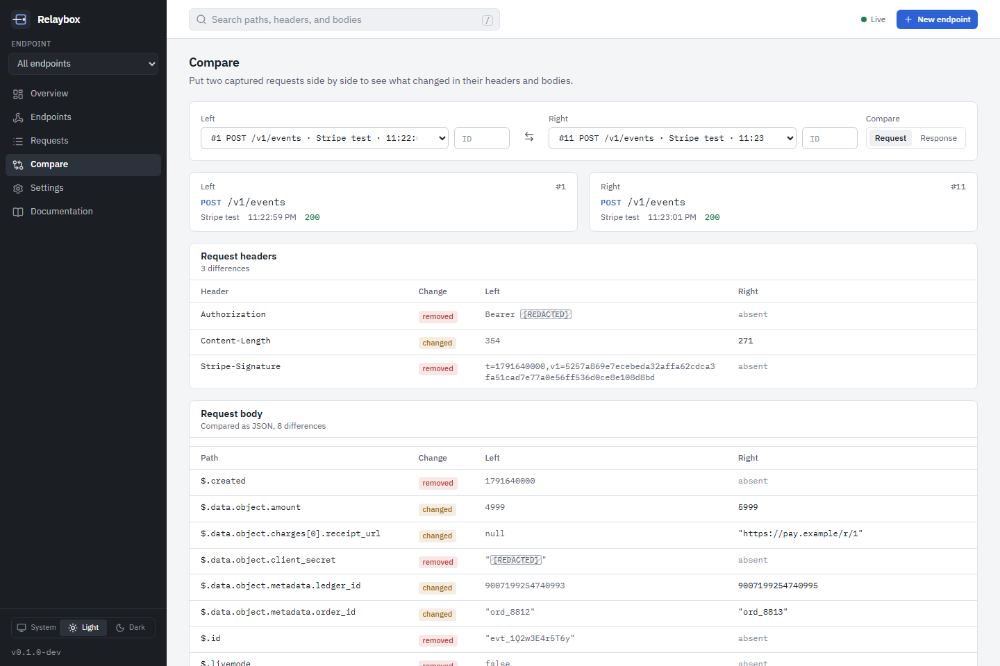

# Relaybox

**Capture. Inspect. Debug.**

Relaybox is a self-hosted tool for debugging webhooks. Create an endpoint, point a service at its URL, and every request that arrives is stored with its headers, query string, and body. You can then inspect it in a local dashboard, search it, compare it with another request, and replay it to your own code. It runs as a single binary with an embedded dashboard and a SQLite database, and it only listens on `127.0.0.1` by default.

> Relaybox is a working name. Trademark and domain availability have not been checked.

## Contents

- [Features](#features)
- [Screenshots](#screenshots)
- [Requirements](#requirements)
- [Quick start](#quick-start)
- [Installation](#installation)
- [Your first webhook](#your-first-webhook)
- [Using curl](#using-curl)
- [Configuration](#configuration)
- [Docker](#docker)
- [Command line](#command-line)
- [API](#api)
- [Data storage and retention](#data-storage-and-retention)
- [Security](#security)
- [Contributing](#contributing)
- [Roadmap](#roadmap)
- [License](#license)

## Features

- **Endpoints.** Create as many as you need. Each gets a random URL that accepts GET, HEAD, POST, PUT, PATCH, DELETE, and OPTIONS, including any sub-path and query string. Disable an endpoint, or replace its URL if it leaks.
- **Mock responses.** Choose the status, content type, headers, body, and an optional delay that each endpoint answers with, and preview the result before saving.
- **Complete capture.** Headers in their original order (including repeated ones), the raw query string, the body (up to a configurable limit, with truncation clearly marked), the sender's address, and how long the response took.
- **Readable bodies.** JSON as a collapsible tree that keeps large numbers exact, plus formatted and raw views. URL-encoded forms as fields, multipart uploads as parts, and binary data as a hex dump. Captured content is always shown as text, never rendered as HTML.
- **Search and filters.** Server-side pagination, filters for endpoint, method, status, source, and date range, sorting, and text search across paths, headers, and bodies.
- **Live updates.** New requests appear as they arrive, without refreshing.
- **Redaction before storage.** Authorization headers, cookies, API keys, passwords, tokens, and other configured headers and fields are replaced with `[REDACTED]` before anything is written to disk, and are marked in the dashboard.
- **Replay.** Send a captured request again, to another endpoint or to a URL, with the method, headers, and body editable. URL replays need explicit confirmation and are protected against reaching private networks and cloud metadata services.
- **Compare.** Put two requests side by side. JSON bodies are compared by path, so you see which fields changed, not which lines.
- **Fixtures.** Export requests to a JSON file with secrets redacted, and import them into any endpoint later. Copy any request as a curl command.
- **Retention.** Keep requests for a number of days and up to a maximum count, run cleanup on demand, and delete single requests, a selection, an endpoint's requests, or everything.
- **Small footprint.** One binary, one SQLite file, no external services. The container image is about 25 MB and runs as an unprivileged user.
- **Scriptable.** Everything in the dashboard uses a documented REST API with an OpenAPI description.

## Screenshots

The overview, in the dark theme:



The request list, with filters and redaction marks:



A JSON body as a tree. The `client_secret` was redacted before storage, and the 16-digit `ledger_id` keeps its exact value:



An endpoint, with its URL, example commands, mock response, body limit, and fixture import and export:



Replaying a request. Redacted headers are not selected, and framing headers such as `Host` are never forwarded:



Comparing two requests:



## Requirements

- **To run a built binary:** nothing else. Relaybox has no runtime dependencies.
- **To build from source:** Go 1.26 or newer and Node.js 22.12 or newer with npm. `make` is optional.
- **To use the container image:** Docker. The Compose file needs Docker Compose 2.24 or newer.

There are no prebuilt releases yet, so for now you build Relaybox yourself or use Docker.

## Quick start

```sh
git clone https://github.com/abood-lmao/relaybox.git
cd relaybox
make deps build
./bin/relaybox serve
```

Then:

1. Open <http://127.0.0.1:8787>.
2. Create an endpoint.
3. Copy its URL.
4. Send a test request, replacing `YOUR_ENDPOINT_ID` with the identifier from the URL:

   ```sh
   curl -X POST "http://127.0.0.1:8787/hooks/YOUR_ENDPOINT_ID" \
     -H "Content-Type: application/json" \
     -d '{"event":"test","message":"hello"}'
   ```

5. Inspect the captured request in the dashboard. It appears without a refresh.

## Installation

### From source

With make (Linux, macOS, or Git Bash and WSL on Windows):

```sh
make deps     # go mod download, npm ci
make build    # builds the dashboard, then bin/relaybox with the dashboard embedded
```

Without make:

```sh
cd web
npm ci
npm run build
cd ..
go build -trimpath -o bin/relaybox ./cmd/relaybox
```

On Windows in PowerShell, the last step is `go build -trimpath -o bin\relaybox.exe .\cmd\relaybox`, and you start the server with `.\bin\relaybox.exe serve`.

The dashboard must be built before the Go binary, because the binary embeds it. `go install` does not build the dashboard, so a binary installed that way shows a page explaining how to build it instead.

Copy `bin/relaybox` anywhere on your `PATH`. It stores data in `./data/relaybox.db` relative to the directory you start it from, unless you set `--database` or `RELAYBOX_DATABASE_PATH`.

### With Docker

See [Docker](#docker).

## Your first webhook

Most services that send webhooks need a URL they can reach. While Relaybox runs on your machine, `http://127.0.0.1:8787/hooks/...` only works for senders on the same machine, such as a local copy of your app, a CLI tool that forwards webhooks, or curl.

For a service on the internet, expose the capture endpoints through a tunnel or reverse proxy, and tell Relaybox the public address so the dashboard shows the right URLs:

```sh
relaybox serve --public-url https://your-tunnel.example.com
```

The dashboard stays local: requests that arrive through the tunnel can reach `/hooks/...`, but not the dashboard or API.

Every captured request is answered with the endpoint's mock response, `200` with `{"received":true}` by default. If your sender expects something else, such as a specific status code, change the mock response on the endpoint page.

## Using curl

```sh
URL=http://127.0.0.1:8787/hooks/YOUR_ENDPOINT_ID

# Sub-paths and query strings are recorded
curl -X POST "$URL/orders/created?attempt=2" -H 'Content-Type: application/json' -d '{"order_id":"ord_1042"}'

# A form
curl -X POST "$URL/status" -d 'status=delivered&token=abc123'

# A file upload
curl -X POST "$URL/upload" -F 'note=receipt' -F 'file=@receipt.pdf'

# Custom headers. The Authorization value is stored as "Bearer [REDACTED]".
curl -X PUT "$URL/items/7" -H 'Authorization: Bearer abc123' -H 'X-Request-Id: 42' --data-binary @item.json
```

In Windows PowerShell, `curl` is an alias for `Invoke-WebRequest`. Use `curl.exe`, or:

```powershell
Invoke-RestMethod -Method Post -Uri "http://127.0.0.1:8787/hooks/YOUR_ENDPOINT_ID" `
  -ContentType "application/json" -Body '{"event":"test","message":"hello"}'
```

[`examples/`](examples) has scripts that send a varied set of sample requests (`send-samples.sh` and `send-samples.ps1`), and ready-made fixture files to import.

## Configuration

Relaybox is configured with environment variables and a few flags. Settings that you change often (retention, the stored request limit, the default body limit, and the redaction lists) can also be changed in the dashboard under **Settings**, where they apply immediately.

| Variable | Default | Purpose |
| --- | --- | --- |
| `RELAYBOX_HOST` | `127.0.0.1` | Address to listen on. |
| `RELAYBOX_PORT` | `8787` | Port. |
| `RELAYBOX_PUBLIC_BASE_URL` | `http://<host>:<port>` | Base of the endpoint URLs shown in the dashboard. |
| `RELAYBOX_DATABASE_PATH` | `./data/relaybox.db` | SQLite database file. |
| `RELAYBOX_MAX_BODY_BYTES` | `1048576` | Largest body stored per request (1 MiB). |
| `RELAYBOX_RETENTION_DAYS` | `7` | Days to keep requests. |
| `RELAYBOX_MAX_STORED_REQUESTS` | `10000` | Maximum number of stored requests. |
| `RELAYBOX_RATE_LIMIT_RPS` | `50` | Requests per second accepted per endpoint. |
| `RELAYBOX_ALLOW_REMOTE_DASHBOARD` | `false` | Allow the dashboard to be used from other machines. Requires a token. |
| `RELAYBOX_DASHBOARD_TOKEN` | not set | Dashboard and API token, at least 24 characters. |

Invalid values stop the server with a message that names the problem. [docs/configuration.md](docs/configuration.md) lists every variable, flag, and setting.

## Docker

```sh
cp .env.example .env
# Set RELAYBOX_DASHBOARD_TOKEN in .env, for example to the output of: openssl rand -base64 32
docker compose up -d --build
```

Open <http://127.0.0.1:8787> and sign in with the token.

Inside a container, the dashboard sees your browser's connections as coming from the Docker network instead of from loopback, so the Compose file runs it in remote-dashboard mode, which requires the token. The port is published on `127.0.0.1` only. Data is kept in the `relaybox-data` volume. The container runs as a non-root user, with a read-only root filesystem and all capabilities dropped.

To run the image without Compose:

```sh
docker build -t relaybox .
docker run -d --name relaybox -p 127.0.0.1:8787:8787 -v relaybox-data:/data \
  -e RELAYBOX_ALLOW_REMOTE_DASHBOARD=true \
  -e RELAYBOX_DASHBOARD_TOKEN="$(openssl rand -base64 32)" \
  relaybox
```

In this mode, replay to URLs is off unless you set `RELAYBOX_ALLOW_REMOTE_REPLAY=true`. Replay into Relaybox endpoints always works. The image has a built-in health check.

## Command line

```text
relaybox serve      Start the server
relaybox cleanup    Apply the retention policy now
relaybox export     Write recent requests to a fixture file
relaybox doctor     Check the configuration, database, dashboard files, and port
relaybox version    Print version information
relaybox help       Show help for a command
```

Examples:

```sh
relaybox serve --port 9000 --database ~/relaybox/dev.db
relaybox doctor
relaybox cleanup --dry-run
relaybox export --endpoint "Payments staging" --limit 50 --out payments.json
```

Exit codes are `0` for success, `1` for failure, and `2` for invalid usage or configuration.

## API

The dashboard is built on a REST API under `/api/v1`, and scripts can use it the same way. From the same machine, no credentials are needed. With a token configured, send `Authorization: Bearer <token>`.

```sh
# The 20 most recent POST requests that mention ord_1042
curl -s 'http://127.0.0.1:8787/api/v1/requests?method=POST&q=ord_1042&limit=20'
```

- [docs/api.md](docs/api.md): conventions, common calls, replay, fixtures, and live events
- [api/openapi.yaml](api/openapi.yaml): the complete OpenAPI 3.1 description, also served at `/api/v1/openapi.yaml`

## Data storage and retention

Everything is stored in one SQLite file, `./data/relaybox.db` by default. The directory is created with permissions for your user only.

- Requests older than the retention period (7 days by default) and requests beyond the maximum count (10,000 by default) are removed automatically every 10 minutes. You can change both under **Settings**, run the cleanup immediately, or run `relaybox cleanup`.
- You can delete single requests, a selection, all requests of an endpoint, or everything. Deleting an endpoint deletes its requests.
- The database is not encrypted. Protect it like any other file with sensitive data.
- To back it up, stop Relaybox and copy the file, or use `sqlite3 relaybox.db ".backup backup.db"` while it runs.

Captured webhooks can contain personal information and secrets. Redaction removes the values it is configured to match, but it cannot recognize every secret. Keep only what you need.

## Security

- **Endpoint URLs work like passwords.** Anyone who has an endpoint URL can send requests to it. Share it only with the services that need it, and replace it on the endpoint page if it leaks.
- **The dashboard is local by default.** It only answers requests from this machine that use a loopback address and carry no proxy headers, which also protects against DNS rebinding. Remote access needs `RELAYBOX_ALLOW_REMOTE_DASHBOARD=true` and a token, and should sit behind TLS.
- **Captured content is untrusted.** It is shown as text, never rendered as HTML or run, under a strict Content Security Policy.
- **Secrets are redacted before storage**, according to lists you can change in **Settings**.
- **Replay only happens when you ask for it.** URL replays need confirmation, follow no redirects, verify TLS, and cannot reach private, loopback, link-local, or cloud metadata addresses.
- **No telemetry.** Relaybox makes no outbound connections except the replays you send.

[docs/security.md](docs/security.md) explains the security model in detail. To report a vulnerability, follow [SECURITY.md](SECURITY.md) and do not open a public issue.

## Contributing

Contributions are welcome. [CONTRIBUTING.md](CONTRIBUTING.md) explains the setup, the checks to run, and what reviewers look for, and [docs/development.md](docs/development.md) covers the code layout and the build. In short:

```sh
make deps
make dev     # Go server on :8787, dashboard with hot reload on http://localhost:5173
make test
make lint
```

On Windows without make, `.\scripts\dev.ps1` starts the development servers. Please follow the [code of conduct](CODE_OF_CONDUCT.md).

## Roadmap

Ideas for after the first release, not commitments:

- Prebuilt binaries and container images for each release
- Signature verification helpers that check an HMAC signature against a secret you provide
- Notes and labels on captured requests
- Per-endpoint redaction rules
- HAR export

Not planned: hosted or multi-tenant features, accounts and billing, external databases or queues, automatic forwarding of captured requests, and telemetry. Relaybox aims to stay a small tool that one developer can run and understand.

## License

[MIT](LICENSE)
